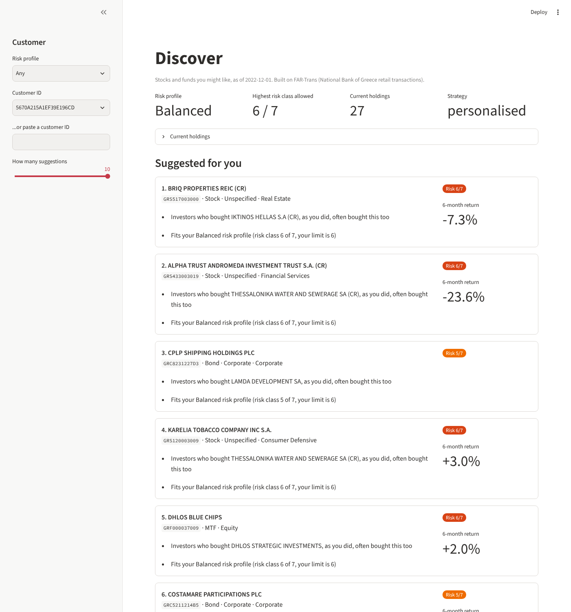
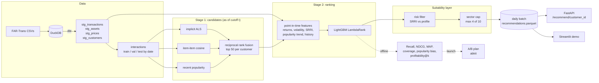

# investor-asset-recs

A two-stage recommender for financial assets, built on real retail investment transactions from
the FAR-Trans dataset. It generates candidates with ALS and item-item models, ranks them with
LightGBM LambdaRank, applies risk-suitability rules, and evaluates on both ranking accuracy and
investor profitability. Served with FastAPI, with an A/B launch plan.

It is the "stocks and funds you might like" list a fintech app would show in its Discover tab.



## Headline results

Test window: 2022-05-30 to 2022-11-30, models trained only on data before 2022-05-30.
Relevance is a customer's **first-time buy** of an asset in the window (the FAR-Trans protocol).

| Model | nDCG@10 | Recall@10 | MAP@10 | Coverage@10 | Monthly ROI@10 |
|---|---:|---:|---:|---:|---:|
| Random | 0.011 | 0.017 | 0.007 | 1.000 | -0.48% |
| Popularity | 0.202 | 0.362 | 0.136 | 0.069 | +0.18% |
| Recent popularity (90 days) | 0.268 | 0.427 | 0.200 | 0.106 | +0.63% |
| Item-item cosine kNN | 0.297 | 0.467 | 0.222 | 0.313 | -0.02% |
| BPR | 0.203 | 0.313 | 0.151 | 0.362 | -0.26% |
| ALS | 0.300 | 0.480 | 0.223 | 0.172 | +0.17% |
| Fused candidates (ALS + kNN + recent pop, RRF) | 0.314 | **0.493** | 0.236 | 0.174 | +0.22% |
| **Two-stage ranker (LambdaRank)** | **0.322** | 0.488 | **0.248** | 0.172 | **+0.51%** |
| Market average (equal weight, all assets) | | | | | -0.46% |

* The ranker beats popularity by **+60% nDCG@10** and ALS by +7%. MAP shows the biggest gain
  over the fused list it reorders (+5%), because it mainly moves the right asset higher.
* Its suggestions also did best on the profitability check: an equal-weight portfolio of each
  customer's top 10 returned +0.51% a month over the next six months while the market average
  lost 0.46% a month. One window is not enough to call this skill, see the rolling benchmark.
* Full tables: [`results/ranker_fixed_split.md`](results/ranker_fixed_split.md) (val and test),
  [`results/mf_tuning.md`](results/mf_tuning.md), [`results/ranker_tuning.md`](results/ranker_tuning.md).

### Against the FAR-Trans paper's baselines

The paper ([Sanz-Cruzado et al., 2024](https://arxiv.org/abs/2407.08692)) averages over 61
cutoffs, two weeks apart from 2019-08-01, each with a six-month test window. This repo
reimplements that protocol (`recs.eval.runner.paper_cutoffs`). The replicated baselines land
within 0.002 of the published numbers, which is a good check that the protocol matches.

| Model | Paper nDCG@10 | This repo nDCG@10 | Paper ROI@10 (monthly) | This repo ROI@10 |
|---|---:|---:|---:|---:|
| Random | 0.0106 | 0.0107 | 0.71% | 0.76% |
| Popularity | 0.2710 | 0.2724 | 0.06% | 0.08% |
| Matrix factorisation | 0.1780 | | 0.38% | |
| LightGCN (paper's best nDCG) | 0.3404 | | 0.04% | |
| Recent popularity (this repo) | | 0.2986 | | -0.48% |
| Item-item kNN (this repo) | | 0.3385 | | -0.04% |
| Market average | | | 0.79% | 0.82% |

All 61 cutoffs; source [`results/baselines_rolling.md`](results/baselines_rolling.md). The ranker
rows on the same protocol are produced by `make rolling`.

## Architecture



### Why each piece is there

**Temporal split, no leakage.** dbt builds the `interactions` table with a train / val / test
split by date (2021-11-30 and 2022-05-30). Every model, feature and label is computed "as of" a
cutoff using only rows strictly before it. Tests in `tests/test_features.py` scramble all
prices and transactions after the cutoff and check the features do not change.

**Two stages.** A cheap stage narrows ~500 tradable assets to 50 per customer. ALS alone reaches
0.80 recall@50 on validation; fusing it with item-kNN and recent popularity by reciprocal rank
fusion lifts that to 0.87, so the ranker sees more of what customers go on to buy. The ranker
is trained on 12 earlier cutoffs (each 4 weeks apart, ending 26 weeks before deployment), and
every label window closes before the deployment date.

**Features that survive regime change.** The first ranker overfit: it peaked after 7 trees and
then got worse. Absolute counts such as all-time buyers drift in scale from one cutoff to the
next. Replacing them with ranks, shares of active buyers and ratios fixed it. The ranker then
improved up to 400 trees.

**Suitability.** Assets get an SRRI-style risk class (1 to 7) from 12-month volatility using
the EU UCITS bands, floored at 5 for single stocks (a flat price usually means a suspension,
not safety). Profiles map to a ceiling: Conservative 3, Income 4, Balanced 6, Aggressive 7,
unknown treated as Conservative. No sector may take more than 40% of the top 10. The filter
runs inside candidate generation, so every customer still gets 10 suitable suggestions.

## What suitability costs

From [`results/suitability_cost.md`](results/suitability_cost.md), test window:

| Ranker variant | nDCG@10 (all buys) | nDCG@10 (suitable buys) | Avg list length |
|---|---:|---:|---:|
| No rules | 0.322 | 0.236 | 10.0 |
| Post-filter: risk + sector cap on the 50 candidates | 0.106 | 0.349 | 5.5 |
| Suitable candidates + sector cap | 0.109 | **0.359** | **10.0** |

* **Without rules, 80% of the ranker's lists include an asset above the customer's risk
  ceiling.** An advised list cannot ship like that.
* With the rules, nDCG against everything customers bought falls by 66%. This is mostly about
  the customers, not the model: 81% of Balanced, 95% of Income and 100% of Conservative
  customers' first-time buys in the test window were above their own profile's ceiling (nearly
  all single Greek stocks). The bank executed those trades on request, but it cannot suggest them.
* Measured on the purchases that *were* suitable, the compliant ranker is 52% better than the
  unconstrained one, and twice as good as compliant popularity (0.180).
* The 40% sector cap alone costs under 1% of nDCG. Aggressive investors lose 1% to the rules.

Per-profile breakdown: [`results/suitability_by_profile.md`](results/suitability_by_profile.md).

## Online test plan

[`docs/ab_test_plan.md`](docs/ab_test_plan.md) covers the A/B test of the ranker against
popularity (both with the suitability layer): the primary metric (30-day buy rate of suggested
assets), guardrails (zero unsuitable suggestions, overall buy rate, regret selling, portfolio
concentration, SRM), and the power calculation. The readout reuses `abkit` from the
[deposit-nudge-experiment](https://github.com/paultaiwo-a/deposit_nudge_experiment) project.

The main finding: the organic 30-day buy rate is 0.74%, so detecting a +20% lift needs about
58,000 customers per arm. FAR-Trans's own active base (4,732) could only detect a lift above
+100%. The plan sets out CUPED, a longer window and a click-through primary as fallbacks.

## How to run

Requires [uv](https://docs.astral.sh/uv/) and Python 3.12.

```bash
make setup
```

```bash
make data
```

```bash
make dbt
```

```bash
make evaluate
```

```bash
make serving
```

```bash
make serve
```

```bash
make app
```

| Target | What it does | Time (4 cores) |
|---|---|---|
| `make data` | Download FAR-Trans (CC-BY 4.0) into `data/raw` | 10 s |
| `make dbt` | Build the DuckDB warehouse and run 20 dbt data tests | 5 s |
| `make baselines` | Baselines on the fixed split and the 61-cutoff paper benchmark | 4 min |
| `make als` | Tune ALS (75 configs) and BPR (24) on validation, log to MLflow | 6 min |
| `make ranker` | Tune and train the ranker, compare with all baselines | 4 min |
| `make rolling` | Ranker and baselines on 31 paper cutoffs | about 1 h |
| `make suitability` | Suitability cost report | 1 min |
| `make abtest` | Power inputs for the A/B plan (installs the `experiment` extra) | 1 min |
| `make serving` | Batch-score all 27,678 customers into `artifacts/serving` | 7 min |
| `make serve` / `make app` | FastAPI on :8000, Streamlit on :8501 | |
| `make test` / `make lint` | pytest (48 tests, synthetic data only) and ruff | 10 s |

MLflow runs are stored in `mlflow.db`; browse them with
`uv run mlflow ui --backend-store-uri sqlite:///mlflow.db`.

### API

```bash
curl localhost:8000/recommend/C0C1FD859E7158D91F44?k=3
```

```json
{
  "customer_id": "C0C1FD859E7158D91F44",
  "risk_level": "Income",
  "max_risk_class": 4,
  "as_of": "2022-12-01",
  "strategy": "personalised",
  "recommendations": [
    {
      "rank": 1,
      "isin": "GRC4261213D5",
      "name": "MOTOR OIL HELLAS CORINTH REFINERIES SA",
      "category": "Bond",
      "risk_class": 4,
      "return_6m": -0.0637,
      "reasons": [
        "Investors who bought MYTILINAIOS SA, as you did, often bought this too",
        "Adds a bond to a portfolio that has none yet",
        "Fits your Income risk profile (risk class 4 of 7, your limit is 4)"
      ]
    }
  ],
  "disclaimer": "Suggestions are for information only and are not personal investment advice. ..."
}
```

Customers with no purchase history get trending assets that fit their profile
(`"strategy": "cold_start"`). Unknown IDs return 404.

### Docker

```bash
make serving && make docker
```

```bash
docker run -p 8000:8000 investor-asset-recs
```

## Repository layout

```
dbt/                    dbt-duckdb project: staging models, interactions split, data tests
src/recs/
  data.py               warehouse loader, point-in-time snapshots
  candidates/           popularity, item-kNN, ALS, BPR, fused candidates
  ranking/              point-in-time features, LambdaRank, training protocol
  rules/                SRRI risk classes, suitability layer
  eval/                 metrics and the rolling FAR-Trans benchmark
  pipelines/            entry points used by the Makefile
  serving.py            daily batch scoring with reasons
api/                    FastAPI service
app/                    Streamlit demo
docs/ab_test_plan.md    online test plan
results/                every table quoted in this README
tests/                  48 tests on a synthetic dataset
```

## Limitations

* **Organic labels.** Relevance comes from what customers bought without seeing any
  suggestions. That is the standard offline setup, but it rewards predicting the herd. The
  A/B test, not these tables, decides whether the ranker is better.
* **Profitability is one market path.** Monthly ROI@10 depends heavily on the window. The
  rolling benchmark is the fairer read; even there, no model here was tuned for returns.
* **Risk classes are approximations.** SRRI is defined on five years of weekly returns for
  funds. This repo uses one year of daily returns for every asset, plus a floor for stocks.
* **Paper comparison is close, not exact.** The paper used its own implementations and tuned
  hyperparameters for ROI on three dates; this repo tunes for nDCG on a validation window. The
  ranker rows use every second paper cutoff to keep the run near an hour.

## Data and citation

FAR-Trans is released by the University of Glasgow under CC-BY 4.0
([doi:10.5525/gla.researchdata.1658](https://doi.org/10.5525/gla.researchdata.1658)). The raw
files are downloaded by `make data` and never committed.

> Javier Sanz-Cruzado, Nikolaos Droukas, Richard McCreadie. FAR-Trans: An Investment Dataset for
> Financial Asset Recommendation. IJCAI-2024 Workshop on Recommender Systems in Finance
> (Fin-RecSys), 2024.
